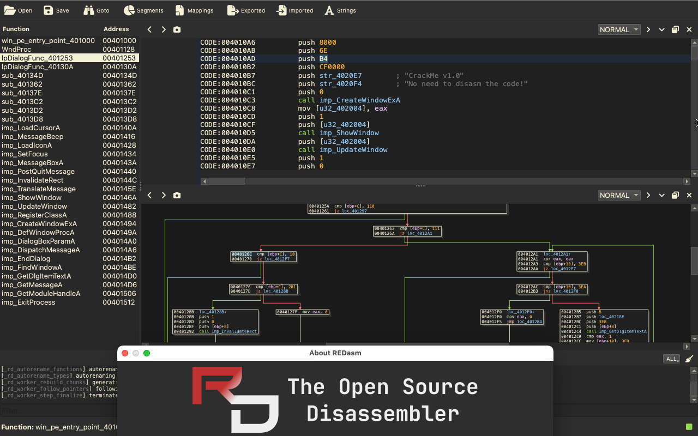
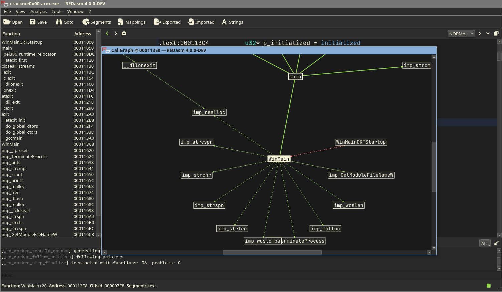
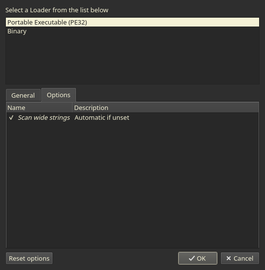
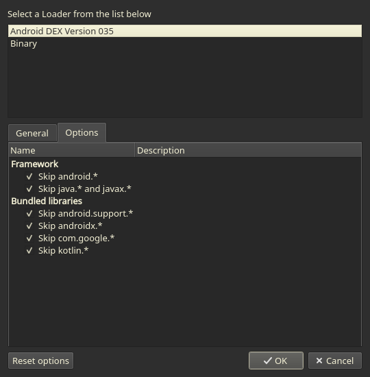

import Info from "../../../../../components/box/Info.astro";

After 3 months of development BETA4 is out!  
This release brings official macOS builds, call graphs, an experimental MCP server, Android support and a lot of retro console love.

Let's see what's new.

## macOS Support
macOS is now officially supported: the CI pipeline provides Universal, Intel and Apple Silicon disk images (.dmg).  
These are the first builds for this OS, so there might be obscure bugs here and there: reports are welcome!

## Call Graphs
Call graphs are one of the foundational features of a disassembler: they give a bird's-eye view of the call
relationships in a binary, without manually scrolling through listings and function graphs.  

## MCP Support
LLMs are becoming very important in the reverse engineering space, and they often make possible
what looked impossible yesterday.  
Now that the core engine is mature enough, an experimental MCP plugin is available: it already covers
the common reversing tasks (browsing functions, strings and cross references, renaming, commenting, typing, patching, project management...),
but less than half of the core API is exposed so far, so expect it to grow.

The MCP plugin is written in C rather than Python, which makes setup hassle-free: it's just a tiny executable,
no venv, no package pinning, no dependency hell.  
The GUI doesn't talk to the MCP server yet (that's planned for the next release), but it's fully functional
with Claude Desktop and other MCP clients.  

See [redasm-mcp repo](https://github.com/redasm-dev/mcp) for usage.

## Android Support
BETA4 can load Android Dex files, backed by a new Dalvik processor plugin and Android definitions in the [knowledge base](https://github.com/redasm-dev/kb/tree/master/platform/android).

## Retro Consoles
Retro platforms got a lot of love in this release:
- **GameBoy, GameBoy Color and GameBoy Advance** loaders, with their hardware definitions in the [knowledge base](https://github.com/redasm-dev/kb/tree/master/platform/gameboy).
- **Sharp SM83** processor plugin (GameBoy and GameBoy Color CPU).
- **Memory banking**, the core engine now understands memory banks, and Segments dialog shows banking information when the format provides it.
- **PlayStation 1**, improved MIPS decoding, more reliable BIOS call detection and listing shows GTE functions.

## Rebasing & Loader Options

The loader selection dialog now exposes loader-specific options and a base address field,
binaries can be rebased at any time from the new Rebase dialog.  

PE and DEX loaders use options, as shown below:

PE Loader Options     |  DEX Loader Options
:-------------------------:|:-------------------------:
 | 

## Analysis Improvements
- Branch table (call/jumps) support.
- Better type rendering: nested types, arrays and field access are resolved and displayed more accurately.
- Improved autonaming, now including arrays.
- PDB v7 support: symbols can also be downloaded from a symbol server or loaded locally.
- Reworked COFF plugin, which now extracts more symbols.
- Better cross referencing on ARM.
- More accurate RTTI and exception handling detection.
- Visual Basic executables: garbage after `ThunRTMain` is no longer disassembled as code.
- `comctl32.dll` ordinals in the knowledge base.

<Info message="Networking is opt-in, so nothing leaves your machine unless you enable it"/>

## GUI
- New Cross References editor.
- Goto now accepts file offsets too.
- Redesigned FLC dialog and reworked menus.
- Updated light & dark themes.
- Lots of small fixes in graph views (node selection, z-order, etc).

## Also in this release
The Linux AppImage is now built against Ubuntu 22.04, so it runs on older distributions too.  
On top of that, plenty of smaller fixes and polish: check out the [full changelog](https://github.com/redasm-dev/redasm/blob/v4.0.0-beta4/CHANGELOG.md) for the complete list.

## Where to get it
BETA4 is available on the [releases page](https://github.com/redasm-dev/redasm/releases/tag/v4.0.0-beta4) for Windows, Linux and macOS.  
Feel free to report bugs or request features in the [bug tracker](https://github.com/redasm-dev/bugs/issues).

## What's next
Work on BETA5 is already in progress and it will be the last of the beta cycle.  
Happy reversing!

